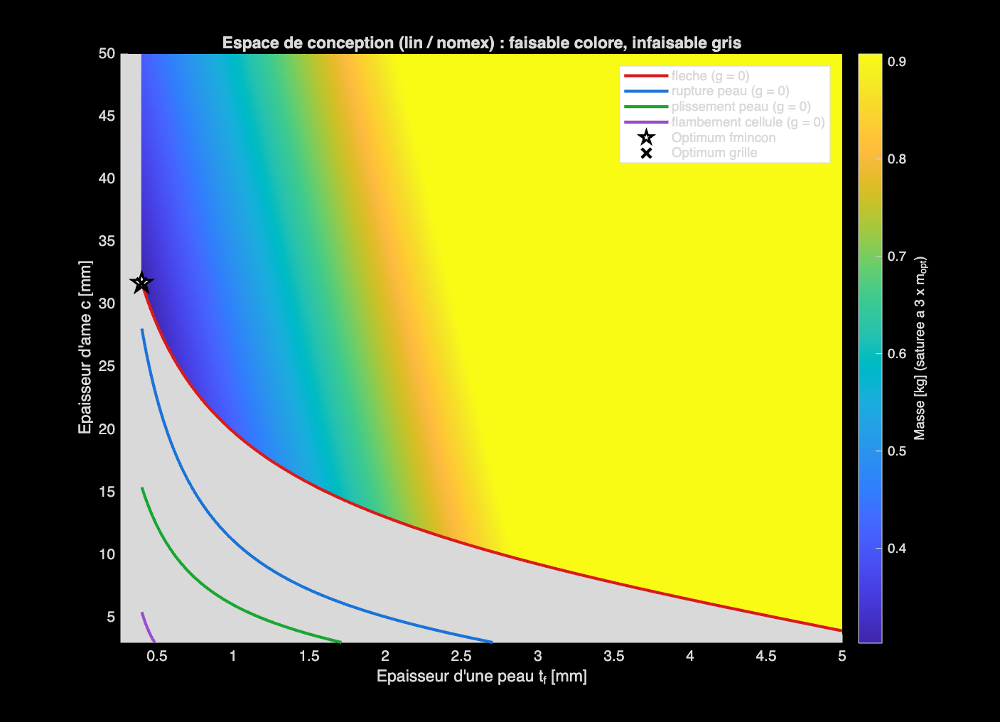
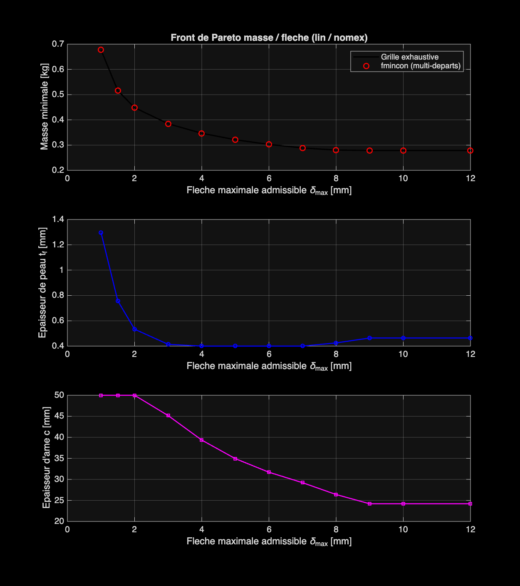
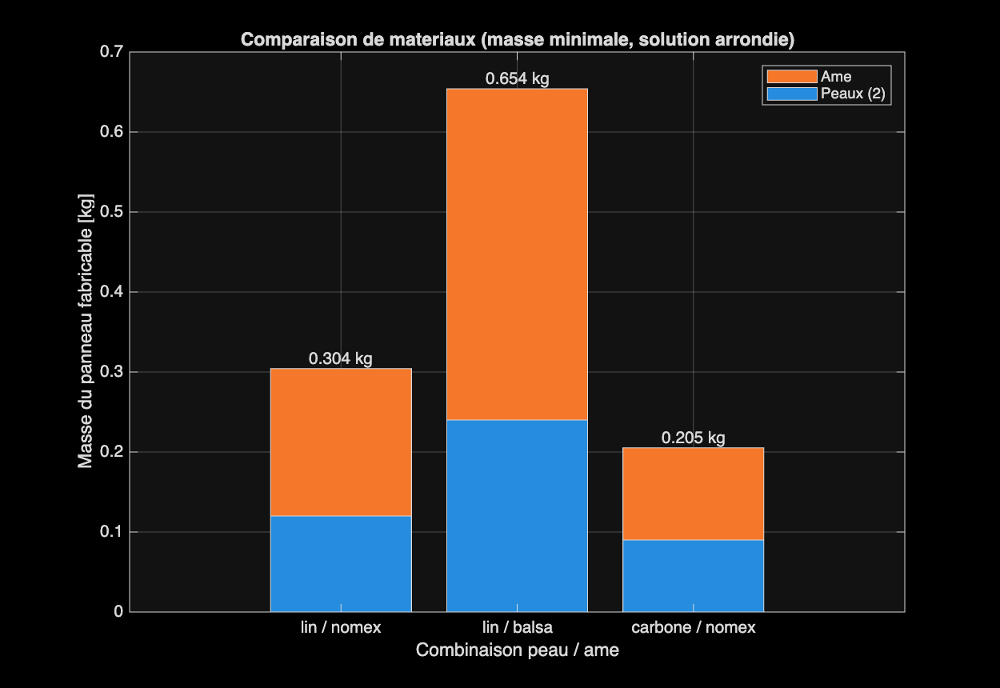

# Composite Sandwich Panel Mass Optimization

A MATLAB-based engineering project for minimizing the mass of a composite sandwich panel under bending, stiffness, strength, and local stability constraints.

The model compares flax-fiber and carbon-fiber composite skins combined with Nomex honeycomb or balsa cores.

**Key features**
- Constrained mass optimization using `fmincon`
- Multi-start optimization and exhaustive grid search
- Manufacturable design selection based on discrete ply thicknesses
- Pareto analysis of mass versus allowable deflection
- Material comparison and sensitivity analysis
- Mechanical consistency checks and design-space visualization

> **Disclaimer:** This project is an educational engineering model. Material properties and loading parameters are illustrative and must be replaced with validated experimental or supplier data before any real-world application.

## Engineering results

For the illustrative reference case, the model predicts a continuous optimum of approximately 0.303 kg and a rounded, manufacturable design of approximately 0.304 kg.

### Feasible design space

### Mass versus allowable deflection

### Material comparison

## Getting started

1. Install MATLAB and the Optimization Toolbox.
2. Clone or download this repository.
3. Add the project folder to the MATLAB path.
4. Run `main`.
5. Review the generated plots and numerical results.

## Model and limitations

The panel is modeled as a beam under three-point bending. The model accounts for bending and core shear deflection, skin strength, core shear strength, local skin instability, and indentation.

The model does not replace finite-element analysis, material characterization, or experimental validation. Its assumptions and limitations should be reviewed before using its predictions for engineering decisions.

## Author

Mechanical engineering | Composite materials | Structural optimization
